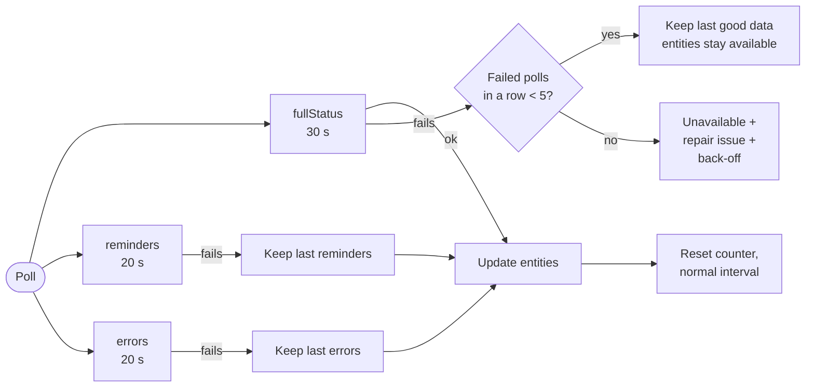
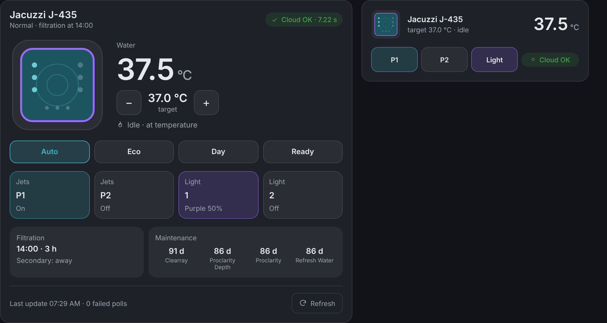
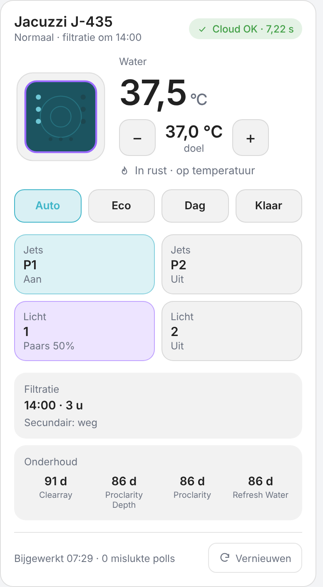
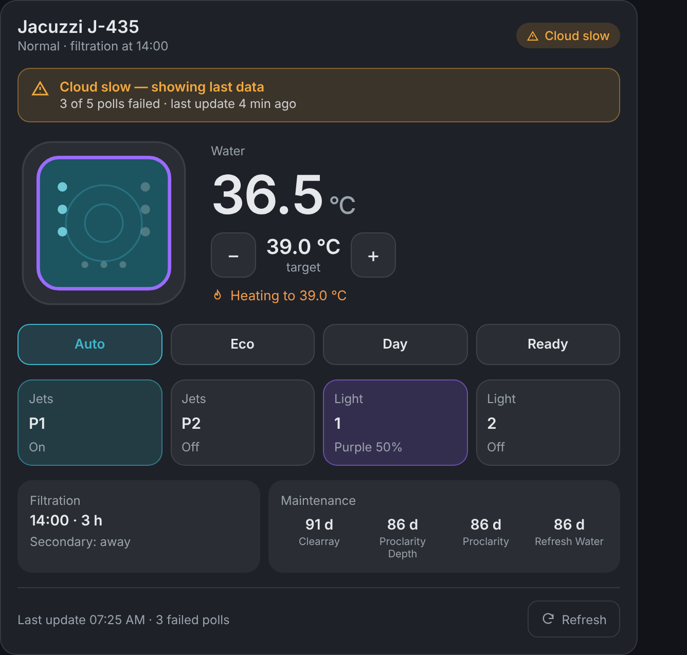

<div align="center">

# 🛁 SmartTub (resilient)

**A drop-in replacement for the Home Assistant SmartTub integration that keeps
your hot tub available — even when the SmartTub cloud is slow.**

[](https://hacs.xyz/docs/faq/custom_repositories/)
[](https://github.com/sschouten/Smarttub/blob/main/CHANGELOG.md)
[](https://github.com/sschouten/Smarttub/actions/workflows/validate.yml)
[](https://www.home-assistant.io/)
[](LICENSE)

[Installation](#-installation) ·
[Features](#-features) ·
[Configuration](#%EF%B8%8F-configuration) ·
[Card](#-smarttub-card) ·
[Entities](#-entities) ·
[Examples](#-examples) ·
[Troubleshooting](#-troubleshooting)

</div>

---

## 🤔 Why?

The SmartTub cloud API (Jacuzzi, Sundance and other SmartTub-connected spas)
regularly needs several seconds per request — sometimes more than 15. The
built-in integration fetches *status*, *reminders* and *errors* together inside
one 10-second timeout. One slow request fails the whole update and **every**
entity becomes `unavailable`, even though the status itself arrived.

The result: dashboards full of grey tiles, automations that stop or trigger on
`unavailable`, and logs full of:

```text
ERROR (MainThread) [homeassistant.components.smarttub.controller] Timeout fetching smarttub data
```

This integration fixes that, while keeping the **same domain and unique IDs**
— your entities, history, dashboards and automations keep working as they are.

## ✨ Features

| | Built-in integration | SmartTub (resilient) |
|---|---|---|
| ⏱️ Status timeout | 10 s, shared with reminders and errors | **30 s**, dedicated |
| 📋 Reminders & errors | Must succeed, or the whole update fails | Own **20 s** timeout, last known values kept |
| 🛡️ A failed poll | Everything `unavailable` | Last good data kept for **5** failed polls in a row |
| 📉 API keeps failing | Polls every 60 s | Interval doubles with jitter, up to **10 min** |
| 🎛️ Commands (jets, lights, heater) | 5 s timeout, error although the tub obeys | **45 s**, unconfirmed commands shown optimistically |
| 🚀 First poll fails at startup | Loads without data, platforms crash | Setup is retried automatically |
| 🔔 Reminder missing at startup | Never created | Added as soon as it appears |
| 🩺 Visibility into the API | — | 5 diagnostic entities, repairs, diagnostics |
| ⚙️ Tuning | — | All of the above configurable in the UI |
| 🃏 Dashboard | — | Built-in `custom:smarttub-card` + ready-made dashboards |
| 🌍 Translations | English | English, Dutch |

All values in **bold** are defaults and can be changed in the
[options](#%EF%B8%8F-configuration).

### How a poll works



## 📦 Installation

### HACS (recommended)

[](https://my.home-assistant.io/redirect/hacs_repository/?owner=sschouten&repository=Smarttub&category=integration)

1. Click the button above, or in HACS open **⋮ → Custom repositories** and add
   `https://github.com/sschouten/Smarttub` with type **Integration**.
2. Search for **SmartTub (resilient)** and click **Download**.
3. Restart Home Assistant.

### Manual

1. Download this repository and copy `custom_components/smarttub` to
   `/config/custom_components/smarttub`.
2. Restart Home Assistant.

### After installing

- **Already using SmartTub?** Nothing to do — your existing configuration is
  taken over automatically, entity IDs stay the same.
- **New to SmartTub?** Go to **Settings → Devices & services → Add integration →
  SmartTub** and log in with your SmartTub app account.

> [!NOTE]
> Home Assistant logs a warning that a custom integration overrides the built-in
> `smarttub` integration. That is expected.

## ⚙️ Configuration

**Settings → Devices & services → SmartTub → Configure**

| Option | Default | Range | Description |
|---|---|---|---|
| Poll interval | 60 s | 15–900 | Time between polls while the API is healthy |
| Status timeout | 30 s | 5–120 | Time allowed for `fullStatus`, which drives almost all entities |
| Reminders/errors timeout | 20 s | 5–120 | Time allowed for reminders and errors; on failure the last values are kept |
| Command timeout | 45 s | 5–180 | Time allowed for a command, including the confirmation |
| Failed polls before unavailable | 5 | 1–30 | Last good data is kept until this many polls in a row failed. `1` = built-in behaviour |
| Maximum poll interval while failing | 600 s | 60–3600 | Upper limit of the back-off; must be at least the poll interval |
| Keep the spa clock in sync | off | on/off | Corrects the spa clock when it is 3+ minutes off (at most once an hour) |

Changing options reloads the integration; no restart needed.

## 🃏 SmartTub card

The integration ships its own dashboard card — no extra download or Lovelace
resource needed. It finds your spa automatically and follows your theme
(light/dark) and language (English/Dutch).

<p align="center">
  <br>
  <em>Full and compact variant (dark theme)</em>
</p>
<p align="center">
  
  &nbsp;&nbsp;
  <br>
  <em>Phone layout in Dutch (light theme) · cloud slow: last known data with a warning</em>
</p>

```yaml
type: custom:smarttub-card
```

| Option | Default | Description |
|---|---|---|
| `device_id` | first spa | The spa to show (pick it in the visual editor) |
| `variant` | `full` | `full` or `compact` |
| `name` | spa name | Title of the card |
| `show_filtration` | `true` | Show the filtration block |
| `show_maintenance` | `true` | Show the maintenance reminders |
| `show_circulation` | `false` | Add a tile for the circulation pump |

What you get:

- A top view of your tub: the jets light up when they run, the rim takes the
  colour of the spa lights.
- Water temperature, target temperature with − / + (changes are bundled into
  one command), heating status and heat modes.
- Tiles for jets and lights; tap to toggle, long-press or right-click for
  details.
- Filtration schedule and days until each maintenance task.
- Cloud health: a banner when the cloud is slow and the card shows the last
  known data, poll duration, failed polls and a refresh button.
- Adapts to its width: four tiles side by side on a desktop, two on a phone.

Add it via **Edit dashboard → Add card → SmartTub**, or use one of the
[ready-made dashboards](dashboards/) (built-in cards, Mushroom, or this card;
English and Dutch).

## 🧩 Entities

All entities of the built-in integration are unchanged. These are added (shown
for a spa named *Jacuzzi J-435*; names follow your spa):

| Entity | Type | What it tells you |
|---|---|---|
| `binary_sensor.<spa>_api_connection` | Connectivity | `on` when the last poll succeeded. Attributes: `holding_last_data`, `consecutive_failures`, `failure_threshold`, `poll_interval`, `last_error` |
| `sensor.<spa>_last_successful_poll` | Timestamp | When data was last received |
| `sensor.<spa>_last_poll_duration` | Duration (s) | How long the last poll took. Attributes per call: `status_duration`, `reminders_duration`, `errors_duration` |
| `sensor.<spa>_consecutive_failed_polls` | Number | Failed polls in a row. Attributes: `total_polls`, `total_failures`, `reminders_failures`, `errors_failures`, `last_error` |
| `button.<spa>_refresh` | Button | Poll the API right now |
| `sensor.<spa>_cellular_signal_strength` / `_quality` | Number | Cellular signal of spas with a cellular link (network and country as attributes) |
| `sensor.<spa>_last_wi_fi_connection` | Timestamp | When the spa was last connected through Wi-Fi |
| `sensor.<spa>_clock_offset` | Duration (min) | How far the spa clock is ahead (+) or behind (−) Home Assistant; the spa clock as attribute |
| `button.<spa>_sync_clock` | Button | Set the spa clock to Home Assistant's time |
| `lock.<spa>_temperature_lock`, `lock.<spa>_spa_lock` | Lock | The spa's control locks (access/maintenance locks are disabled by default) |

These diagnostic entities stay available while polling fails, so you can
always see what is going on.

### Spa clock

The filtration schedule runs on the spa's own clock, which does not follow
daylight saving time. Check `sensor.<spa>_clock_offset`, press
**Sync clock**, enable **Keep the spa clock in sync** in the options, or set
it yourself:

```yaml
action: smarttub.set_date_time
target:
  entity_id: climate.jacuzzi_j_435_thermostat
data:
  date: "2026-11-03"
  time: "11:30:00"
```

### Energy usage

The action `smarttub.get_energy_usage` returns the energy usage the SmartTub
cloud reports, per day (default: last 7 days) or per month:

```yaml
action: smarttub.get_energy_usage
target:
  entity_id: climate.jacuzzi_j_435_thermostat
data:
  interval: day
```

### Repairs

| Issue | When |
|---|---|
| **SmartTub cloud API unreachable** | The failure threshold was reached. Clears itself after the next successful poll. |
| **Built-in SmartTub integration changed** | After a Home Assistant update the built-in integration differs from the version this one is based on. Check the release notes to decide whether you still need this integration. |

### Diagnostics

**Settings → Devices & services → SmartTub → ⋮ → Download diagnostics** includes
the poll statistics and options next to the spa data. E-mail, password, serial
numbers, Wi-Fi name and sensor addresses are redacted.

## 💡 Examples

### Notify when the SmartTub cloud has been unreachable for 15 minutes

```yaml
alias: SmartTub – cloud unreachable
triggers:
  - trigger: state
    entity_id: binary_sensor.jacuzzi_j_435_api_connection
    to: "off"
    for:
      minutes: 15
actions:
  - action: notify.notify
    data:
      title: SmartTub
      message: >
        No data from the SmartTub cloud for 15 minutes
        ({{ state_attr('binary_sensor.jacuzzi_j_435_api_connection', 'last_error') }}).
mode: single
```

### Only act on fresh data

Use the last successful poll in a condition, for example before changing the
temperature based on energy prices:

```yaml
conditions:
  - condition: template
    value_template: >
      {{ now().timestamp()
         - as_timestamp(states('sensor.jacuzzi_j_435_last_successful_poll'), 0)
         < 600 }}
```

### Error notification without false alarms

Trigger on a real change only, not on `unavailable` → `on`:

```yaml
triggers:
  - trigger: state
    entity_id: binary_sensor.jacuzzi_j_435_error
    from: "off"
    to: "on"
```

## 🔧 Troubleshooting

<details>
<summary><b>Entities still become unavailable</b></summary>

Check `sensor.<spa>_consecutive_failed_polls` and the `last_error` attribute.
If the API is down for longer than *failed polls × poll interval*, entities
become unavailable by design. Raise **Failed polls before unavailable** or the
**Status timeout** if your API is slow but not down.
</details>

<details>
<summary><b>A command shows the new state, but the tub has not changed yet</b></summary>

The SmartTub API accepted the command but did not confirm it within its
confirmation window. The new state is shown optimistically and corrected by the
next poll (at most 3 minutes later). If the command really failed, the next
poll shows the actual state.
</details>

<details>
<summary><b>Debug logging</b></summary>

```yaml
logger:
  logs:
    custom_components.smarttub: debug
    homeassistant.components.smarttub: debug
    smarttub: debug
```

Or use **Settings → Devices & services → SmartTub → ⋮ → Enable debug logging**.
</details>

<details>
<summary><b>Going back to the built-in integration</b></summary>

1. Remove the repository in HACS, or delete `/config/custom_components/smarttub`.
2. Restart Home Assistant.

The built-in integration takes over the same configuration and entities. The
five diagnostic entities are left orphaned; remove them under
**Settings → Entities**.
</details>

## 🧪 Development

The tests run inside the Home Assistant core test harness (the same fixtures
and snapshot as the built-in integration, plus tests for the resilience
features):

```bash
scripts/run_core_tests.sh 2026.10.4
```

Every push is checked by [hassfest](https://developers.home-assistant.io/blog/2020/04/16/hassfest/),
the HACS action and the test suite. See [CONTRIBUTING.md](CONTRIBUTING.md).

The core of the fix is also available as a patch for Home Assistant core in
[`upstream/`](upstream/).

## 🙏 Credits

- Based on the built-in SmartTub integration of
  [Home Assistant](https://github.com/home-assistant/core), originally by
  [@mdz](https://github.com/mdz).
- Uses the [python-smarttub](https://github.com/mdz/python-smarttub) library.

## 📄 License

[Apache License 2.0](LICENSE), like Home Assistant itself.

This project is not affiliated with or endorsed by Jacuzzi, SmartTub or Home
Assistant.
